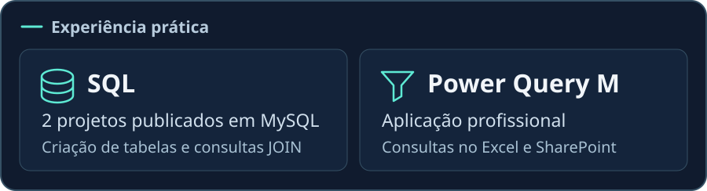

Profissional de Operações e estudo Análise e Desenvolvimento de Sistemas.

## Linguagens aplicadas

## Tecnologias

## Competências técnicas

| Categoria | Competências |
| --- | --- |
| CRM | HubSpot, Salesforce, Leads 2b |
| ERP e sistemas | SAP, SAP Business One, plataformas de e-procurement |
| Dados e indicadores | Excel, Power Query, SQL, dashboards, KPIs, análise de dados e Power BI *(em desenvolvimento)* |
| Operações e processos | SLA, gestão de processos, melhoria contínua, funil de vendas e pós-vendas |
| Metodologias e gestão | Scrum, Kanban, ITIL, COBIT, PMBOK e Lean IT |
| Tecnologia e conformidade | AWS Cloud Operations, ISO/IEC 27001 e ISO 9001 |
| Produtividade | Microsoft Office, Google Workspace e Trello |

## Projetos em destaque

| Projeto | O que você encontra |
| --- | --- |
| [Sistema Mercado](https://github.com/victtorcarvalho/banco-de-dados-supermercado) | Modelagem e script MySQL para compras e pagamentos do Supermercado Boa Compra. |
| [Gestão Acadêmica](https://github.com/victtorcarvalho/sistema-gerenciamento-de-dados) | Banco relacional para alunos, turmas e histórico acadêmico, com uma consulta de exemplo em SQL. |
